# Screenshot tour

Taken from the running demo (demo trucks and photos, not real data).

## Driver, on the phone

| | |
|---|---|
| 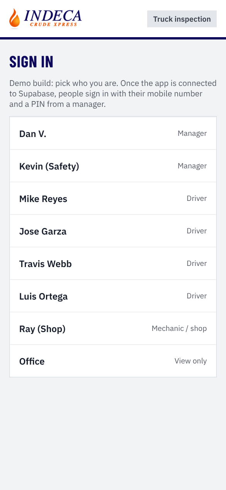 | **Sign in.** The demo lets you pick a person. The real build uses mobile number + PIN, like the Ticket Log. |
| 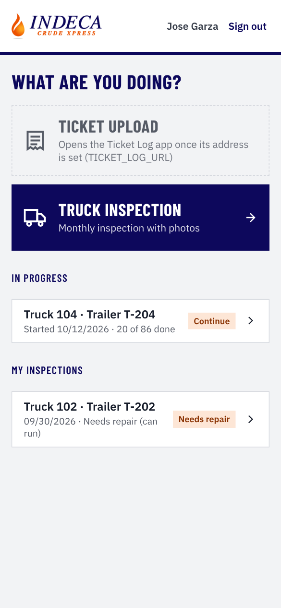 | **"What are you doing?"** Ticket upload (opens the Ticket Log) or Truck inspection. Unfinished inspections and past ones are listed underneath. |
| 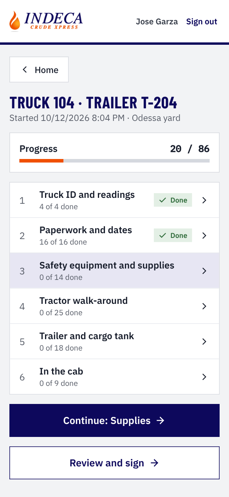 | **The inspection.** Six sections with progress. Leave any time and pick it up later. Open defects from the truck's last inspection show at the top. |
| 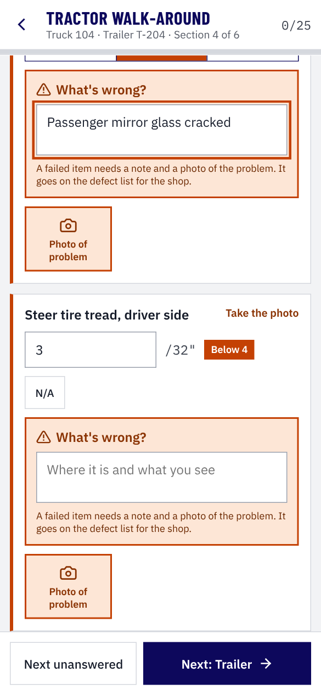 | **Answering.** Pass / Fail / N/A. A fail asks what's wrong and wants a photo. Tread depth below the minimum fails by itself. |
| 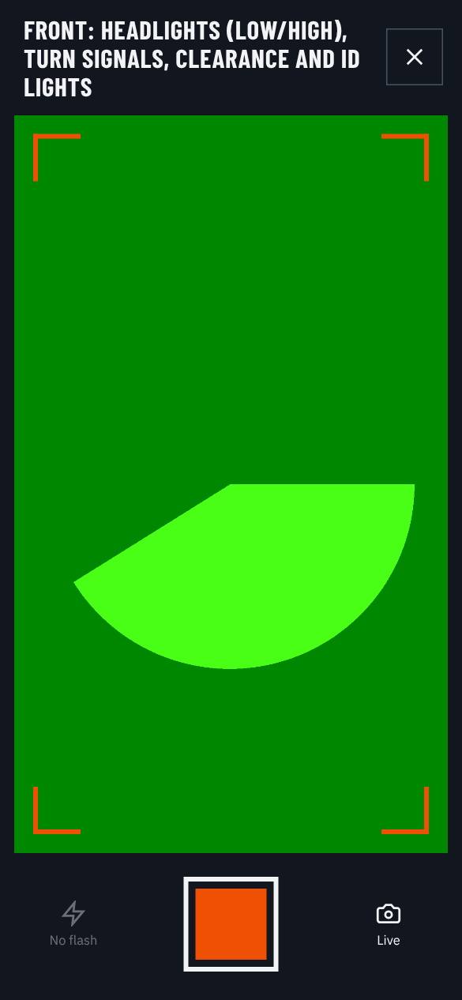 | **Live camera only**, with flash where the phone allows. (The demo's test camera shows a green test pattern.) |
| 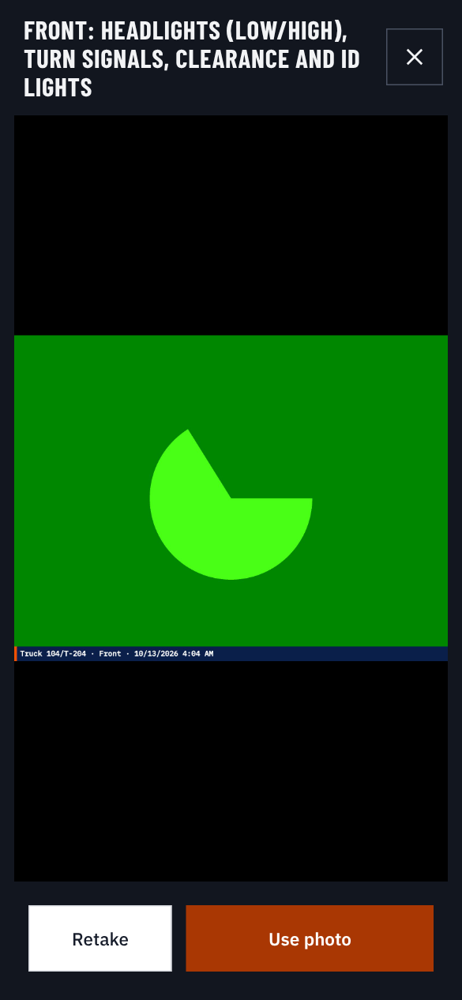 | **Every photo is stamped** with the truck, item, date and time before upload. |
| 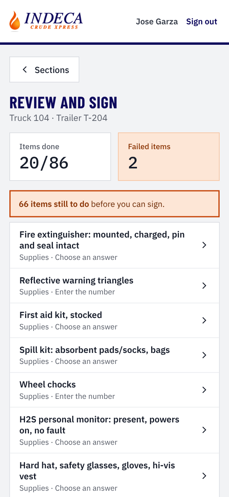 | **Review and sign.** Lists what's still missing and every defect. Choose In service / Needs repair / Out of service and type your name to lock it. |
| 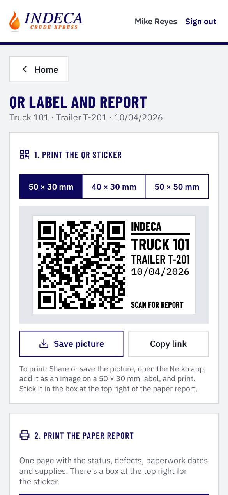 | **The QR sticker** for the Nelko PM220 in three sizes. On a phone, "Share to Nelko app" sends it straight to the printer app. |
| 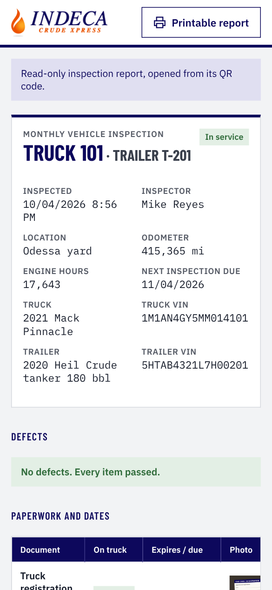 | **What the QR opens:** the read-only report with every photo. No sign-in needed; only that one report. |

## The paper report

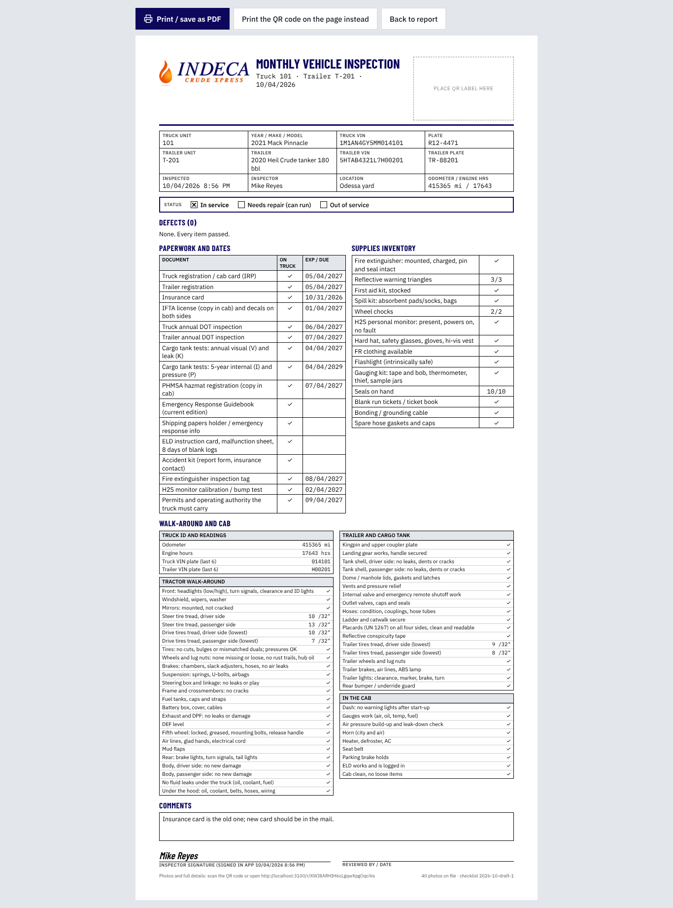

One Letter page: unit info, status, defects, paperwork dates, supplies, the full walk-around,
comments and signatures. The dashed box at the top right is for the QR sticker.

## Managers and the shop

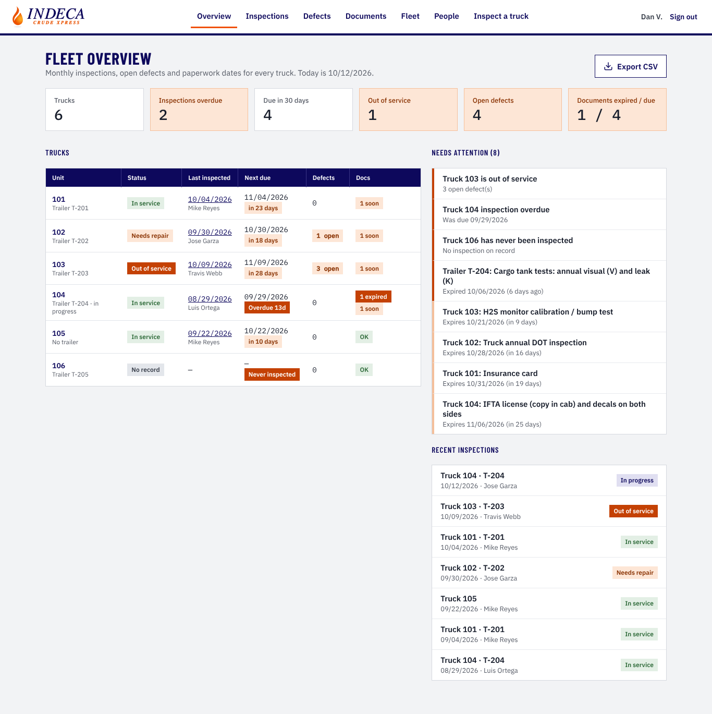

**Fleet overview:** what's overdue, out of service, open defects, documents expiring, and every truck's status.

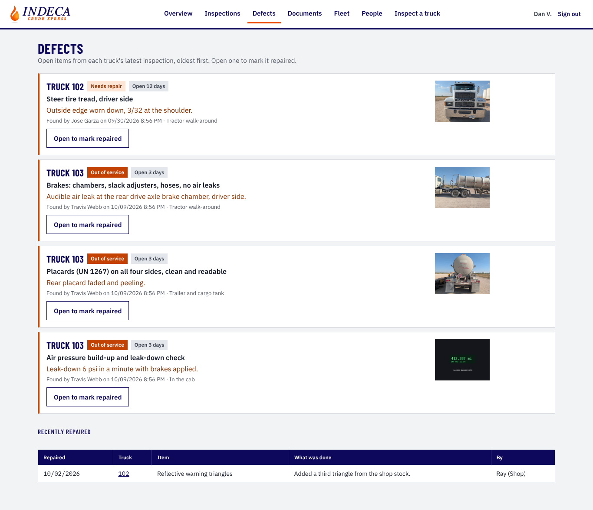

**Defects:** the shop's worklist, oldest first, with photos, plus recent repairs.

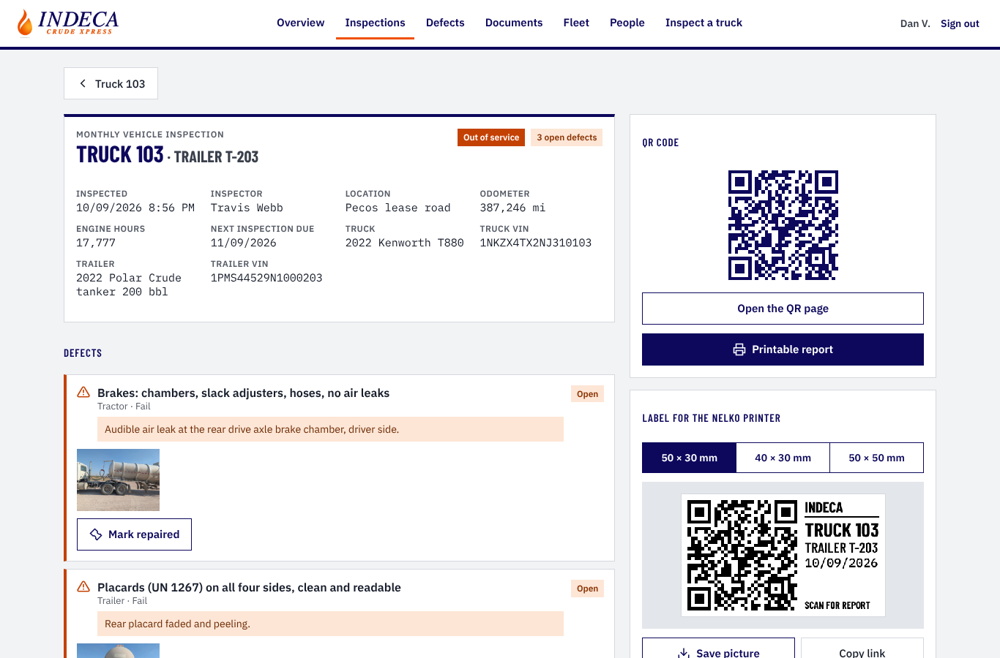

**One inspection:** the full report, "Mark repaired" on each defect, the QR code and the sticker maker.

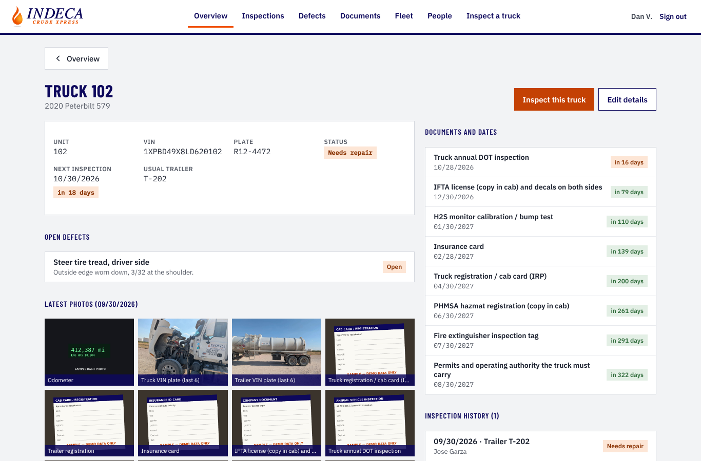

**One truck:** status, next due date, document dates, history and the latest photos.

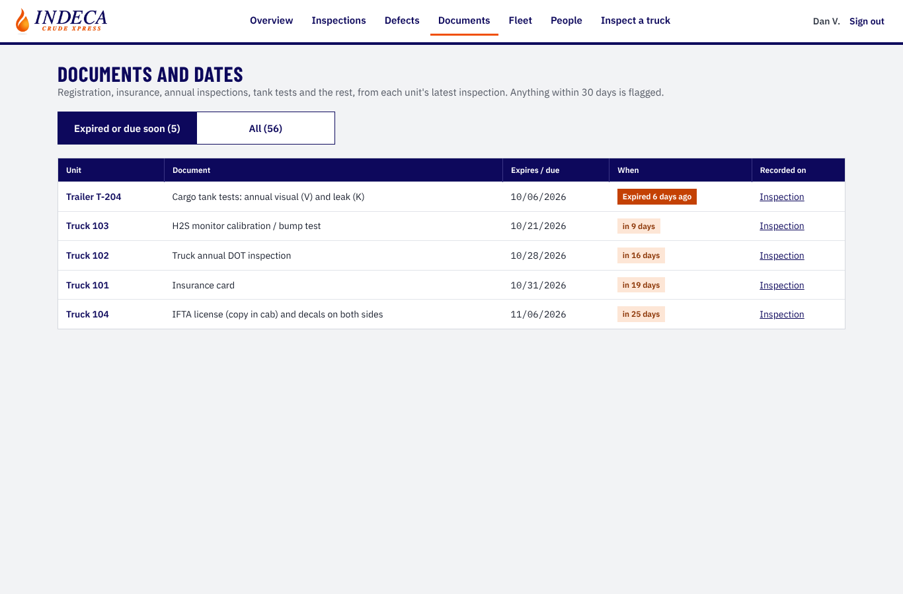

**Documents:** every expiration and due date that's past or within 30 days.

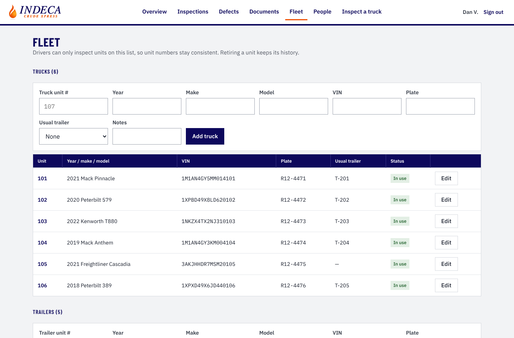

**Fleet:** add and edit trucks and trailers. Drivers can only inspect units on this list.
